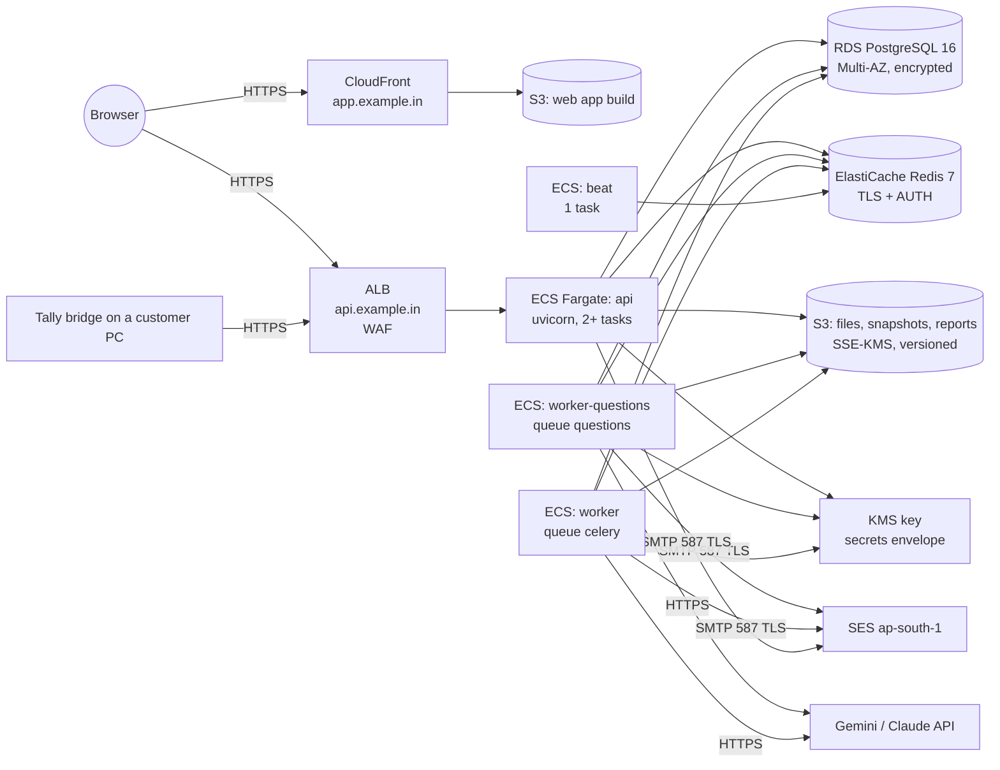

# Production deployment guide: AWS `ap-south-1` (Mumbai)

A guide for the first production setup, written for the person who will run it. Nothing here has been run against
AWS yet (M19 is a guide only): expect to adjust names and sizes, and do the first deploy on a staging account.
Everything stays in India (BUILD_SPEC 6.6 "data residency"): `ap-south-1`, with `ap-south-2` (Hyderabad) for backup
copies.

## 1. The shape

| Piece | AWS service | Starting size (pilot, ~50 workspaces) |
|---|---|---|
| Web app (`frontend/` build) | S3 (private) + CloudFront with Origin Access Control | - |
| API | ECS Fargate service `api` behind an Application Load Balancer | 2 tasks x 1 vCPU / 2 GB, 2 uvicorn workers each |
| Questions worker | ECS service `worker-questions`: `celery ... worker -Q questions` | 1-2 tasks x 2 vCPU / 4 GB, `--concurrency 8` |
| Background worker | ECS service `worker`: `-Q celery` (syncs, long tasks, briefings, purges) | 1 task x 2 vCPU / 4 GB, `--concurrency 4` |
| Scheduler | ECS service `beat`, exactly **1** task | 0.25 vCPU / 0.5 GB |
| App database | RDS for PostgreSQL 16, Multi-AZ, gp3, storage encrypted (KMS) | db.t4g.medium, 50 GB autoscaling |
| Cache / broker | ElastiCache for Redis 7 (or Valkey), in-transit TLS and AUTH token | cache.t4g.small, 1 replica |
| Files | S3 bucket `analyst-prod-data`, SSE-KMS, versioning, Block Public Access | - |
| Secrets envelope | KMS customer-managed key `alias/analyst-secrets` | - |
| Email | SES in `ap-south-1`, domain verified (DKIM, SPF, DMARC), production access | - |
| App secrets | Secrets Manager, injected into ECS task definitions | - |
| Logs and alarms | CloudWatch Logs (JSON lines), CloudWatch alarms, SNS to the on-call email | - |

The workers are I/O-bound (they wait on the AI provider), so their concurrency is above their vCPU count; memory is
the limit (each prefork process holds pandas and DuckDB, about 250-400 MB).

## 2. Network

- One VPC, 3 Availability Zones. Public subnets: the ALB and NAT gateways only. Private subnets: ECS tasks, RDS,
  ElastiCache. No public IPs on tasks.
- Security groups: ALB accepts 443 from anywhere (and 80, redirected to 443); `api` accepts 8000 from the ALB only;
  RDS accepts 5432 and ElastiCache 6379 from the four ECS services only; nothing else inbound.
- Outbound through NAT: the AI providers, Google, Shopify, Zoho, Razorpay, customers' databases. VPC endpoints
  (gateway for S3, interface for KMS, Secrets Manager, CloudWatch Logs, ECR) keep AWS traffic off the NAT.
- Customer databases (M14) are reached from the workers' NAT addresses: publish the NAT gateways' Elastic IPs in
  docs/SETUP_DATABASES.md so customers can allow-list them. Private addresses stay refused (D101); never add
  `DB_DEV_ALLOWED_HOSTS` in production.

## 3. TLS and domains

- ACM certificates: `api.example.in` in `ap-south-1` (for the ALB) and `app.example.in` in `us-east-1` (CloudFront
  requires that region for its certificates).
- ALB listener 443 with the `ELBSecurityPolicy-TLS13-1-2-2021-06` policy; 80 redirects to 443.
- CloudFront: HTTPS only, TLSv1.2_2021 minimum, HTTP/2 and HTTP/3.
- `APP_BASE_URL=https://app.example.in`, `API_BASE_URL=https://api.example.in`. With an `https://` API address the
  refresh and CSRF cookies are `Secure` and the API sends HSTS (`COOKIE_SECURE=auto`).
- Client addresses: the ALB appends the caller to `X-Forwarded-For`, so set `TRUSTED_PROXY_HOPS=1` (2 if CloudFront
  ever fronts the API too). Do **not** also turn on uvicorn's `--forwarded-allow-ips='*'`: the app reads the header
  itself, and two readers would trust caller-written entries.
- Google OAuth and the Picker, Shopify and Zoho apps: register the production redirect URLs on the `api.` domain
  (docs/SETUP_GOOGLE.md, SETUP_SHOPIFY.md, SETUP_ZOHO.md).

## 4. Secrets and configuration

Every variable in `.env.example`, set per environment. Secrets go to **Secrets Manager** (one secret per value or
one JSON secret), referenced from the ECS task definitions (`secrets:`), never in the image, the task definition's
plain `environment:` or the repository.

| Variable | Production value |
|---|---|
| `APP_ENV` | `production` (JSON logs; refuses weak keys; no `/docs`; stand-ins off) |
| `DATABASE_URL` | `postgresql+psycopg://analyst_app:<secret>@<rds endpoint>:5432/analyst?sslmode=verify-full&sslrootcert=/etc/ssl/rds-ca.pem` (bundle the RDS CA in the image) |
| `REDIS_URL` | `rediss://:<auth token>@<elasticache endpoint>:6379/0` (`rediss` = TLS) |
| `S3_ENDPOINT` / `S3_BUCKET` / `S3_REGION` | `https://s3.ap-south-1.amazonaws.com` / `analyst-prod-data` / `ap-south-1`. Leave `S3_ACCESS_KEY` and `S3_SECRET_KEY` empty: the app then uses the ECS task role (give it `s3:GetObject`, `PutObject`, `DeleteObject`, `ListBucket` on this bucket only, and `kms:Encrypt`, `Decrypt`, `GenerateDataKey` on its keys). |
| `KMS_KEY_ID` | the key ARN of `alias/analyst-secrets`: secrets are wrapped by KMS (`KmsKeyWrapper`, the same `KeyWrapper` interface as `MASTER_KEY`). **Start production on KMS**: an installation that began on `MASTER_KEY` needs a re-wrap first (SECURITY.md 5.5). |
| `MASTER_KEY`, `JWT_SECRET` | 32+ random bytes each (`openssl rand -base64 32`), from Secrets Manager. The start-up check requires both in production. |
| `SMTP_HOST` / `SMTP_PORT` / `SMTP_USER` / `SMTP_PASSWORD` / `EMAIL_FROM` | `email-smtp.ap-south-1.amazonaws.com` / `587` / SES SMTP credentials (STARTTLS is used whenever a user is set) / `Analyst <no-reply@example.in>` |
| `GEMINI_API_KEY` (and `ANTHROPIC_API_KEY`) | the **paid** tier key (no training on customer data, BUILD_SPEC 6.6) |
| `TRUSTED_PROXY_HOPS` | `1` |
| `DB_POOL_SIZE` / `DB_MAX_OVERFLOW` | API tasks: `5` / `10`. Worker tasks: `2` / `3` (one task runs one job per process). |
| `GOOGLE_*`, `SHOPIFY_*`, `ZOHO_*` | the production apps' credentials |
| `BILLING_PROVIDER` | `stand_in` (nothing is charged, D118) |

**Database connection budget.** Each process has its own pool: API = tasks x uvicorn workers x (pool + overflow) =
2 x 2 x 15 = 60; questions worker = 2 tasks x 8 processes x 5 = 80; worker = 4 x 5 = 20; beat about 2. 162 at the very
most, against about 400 `max_connections` on db.t4g.medium. The M19 load test used at most 6 per pool with 50 people
asking at once. Add RDS Proxy before raising task counts a lot.

The database user: the migrations run as an owner role (`analyst_owner`); the app can run as the same role (it must
be allowed `SET ROLE app_tenant`, which the migrations grant to the role that runs them). Do not use the RDS master
user for the app.

## 5. Images, migrations and releases

Production image: the repository's `backend/Dockerfile` is the development image. For production, build from it with
these changes: `uv sync --frozen --no-dev` (no test tools in the image), run as a non-root user, no bind mounts, the
RDS CA bundle copied in, `CMD ["uvicorn", "app.main:create_app", "--factory", "--host", "0.0.0.0", "--port", "8000",
"--workers", "2"]` for `api` (no `--reload`). Workers use the same image with `celery -A app.tasks.celery_app:celery_app
worker -Q questions --concurrency 8` (or `-Q celery --concurrency 4`), beat with `... beat
--schedule=/tmp/celerybeat-schedule`. Push to ECR with image scanning on; tag with the git commit.

Web app: `cd frontend && VITE_API_BASE_URL=https://api.example.in npm ci && npm run build`, upload `dist/` to the web
bucket (`index.html` with `Cache-Control: no-cache`, hashed assets with `max-age=31536000, immutable`), invalidate
`/index.html`.

**A release** (CI on a tag, or by hand):
1. `make check` and `make e2e` green on the commit; `make backup-drill` if the release has migrations.
2. Take a manual RDS snapshot named after the release (`pre-<version>`).
3. Run migrations as a **one-off ECS task** with the new image: `alembic upgrade head`. In production the `api`
   command does not run migrations itself (unlike `docker-compose.yml`), so two starting tasks never race.
4. Deploy the new task definitions: `worker-questions`, `worker`, then `api` (rolling, minimum healthy 100%, the
   ALB health check on `/health`, the deployment circuit breaker with rollback on), then `beat` (stop the old one
   first: never two beats).
5. Upload the web app build; invalidate CloudFront.
6. Smoke test: `/health/ready` is `ok`; sign in; open Today; open a connection; ask a question.

Migrations are written to be reversible and **additive first** (add a column, deploy code that writes both, remove
later), so the previous release still runs against the new schema during the rolling update.

**Rollback:**
- Code only: redeploy the previous task definition revision for each service (ECS keeps them), and the previous web
  build (keep the last three `dist/` folders in the bucket under versioned prefixes).
- With a migration: if the old code runs on the new schema (additive), roll back code only. Otherwise run the
  one-off task `alembic downgrade <previous revision>` with the **new** image (it has the downgrade), then roll the
  code back. If a downgrade would lose data, restore the `pre-<version>` snapshot instead
  (docs/RUNBOOK_BACKUP_RESTORE.md section 2).

## 6. Edge protection and headers

- **AWS WAF** on the ALB: the AWS managed common rule set and known-bad-inputs, and a rate-based rule (for example
  1,000 requests per 5 minutes per IP, 100 for `/auth/*`). The app keeps its own limits (SECURITY.md 7); WAF stops
  floods before they reach it. Body size: the app caps bodies itself (4 MB, uploads 50 MB); keep WAF's body
  inspection limit at its default.
- The API sends its own security headers (CSP, nosniff, frame denial, no-referrer, no-store, HSTS).
- **CloudFront response headers policy for the web app** (the SPA's own headers):
  - `Strict-Transport-Security: max-age=31536000; includeSubDomains; preload`
  - `Content-Security-Policy: default-src 'self'; script-src 'self' https://apis.google.com; style-src 'self'
    'unsafe-inline'; img-src 'self' data: blob: https://*.googleusercontent.com; font-src 'self'; connect-src
    'self' https://api.example.in; frame-src https://docs.google.com https://drive.google.com; frame-ancestors
    'none'; base-uri 'self'; form-action 'self' https://api.example.in; object-src 'none'`
    (the Google Picker needs its script and frames; inline styles come from the charts. Try it first as
    `Content-Security-Policy-Report-Only` on staging and open every screen.)
  - `X-Content-Type-Options: nosniff`, `Referrer-Policy: strict-origin-when-cross-origin`,
    `X-Frame-Options: DENY`, `Permissions-Policy: camera=(), microphone=(), geolocation=()`.
- S3 buckets: Block Public Access on all four settings; the data bucket's policy denies non-TLS requests
  (`aws:SecureTransport = false`) and uploads without SSE-KMS.

## 7. Monitoring and alarms

Logs: every service logs JSON lines to CloudWatch Logs (`/analyst/api`, `/analyst/worker`, ...) with request ids;
secrets, tokens and emails are redacted in the app (SECURITY.md 6). Retention 180 days (CERT-In asks for 180 days
of logs, kept in India).

Alarms (to SNS -> the on-call email):

| Alarm | Threshold |
|---|---|
| ALB 5xx from targets | > 1% of requests over 5 min |
| ALB target response time p95 | > 1.5 s over 10 min (load test p95 was under 0.1 s locally) |
| `/health/ready` failing (Route 53 health check or a synthetic canary) | 2 checks in a row |
| ECS running task count below desired, per service | 5 min |
| Celery queue depth (`LLEN questions`, `LLEN celery`, a small Lambda or the beat heartbeat publishing a metric) | questions > 50 for 5 min; celery > 500 for 15 min |
| RDS CPU > 80%, free storage < 20%, connections > 300, replica lag | 10 min |
| ElastiCache memory > 75%, evictions > 0 | 10 min |
| SES bounce rate > 2% or complaint rate > 0.1% | AWS's own sending limits are at 5% / 0.5% |
| KMS `Decrypt` errors, unusual volume | any errors |
| AWS Budgets: the monthly bill, and the AI providers' own spend alerts | 80% of plan |

Also: GuardDuty and Security Hub on; CloudTrail to an S3 bucket in a separate log account; RDS Performance
Insights; ECR scan findings reviewed weekly. AI usage per workspace is already in the app (`usage_events`, Settings >
AI usage); watch the platform key's daily quota in the provider's console.

## 8. Before launch (checklist)

- [ ] Staging account set up from this guide, a full release and a rollback rehearsed.
- [ ] `make backup-drill` green; an RDS point-in-time restore done on staging and timed.
- [ ] SES out of the sandbox; DKIM, SPF and DMARC pass; the "new sign-in" and briefing emails arrive.
- [ ] Google app verification (docs/SETUP_GOOGLE.md), Shopify and Zoho production apps approved.
- [ ] The real-provider checks still untested (docs/PROGRESS.md): Gemini answers (`make eval`, >= 85%), Razorpay,
      Shopify, Zoho Books, Tally on Windows, a managed customer database.
- [ ] **Industry templates reviewed by someone who knows each trade** (retail, D2C, restaurant, fuel station,
      services, manufacturing): their KPIs, playbook tweaks and default what-if elasticities were written from
      general business knowledge, not from data (DECISIONS D115).
- [ ] An external penetration test; SECURITY.md open items reviewed.
- [ ] Privacy policy and terms published (the marketing site, M10b, is not built yet).
